# CivicPulse: Civic Infrastructure Complaint Management System

**DBMS Experiential Learning, Level 3 Project**
Department of Computer Science and Engineering, PES University

| Team member | SRN |
|---|---|
| Annamalai N | PES1UG24CS068 |
| Anshul Poovaiah K | PES1UG24CS071 |

---

## 1. Objectives

Public infrastructure problems such as potholes, damaged roads, broken footpaths and pavements, overflowing garbage, dark street lights, blocked drains and open manholes are reported informally today, through phone calls, social media posts or ward offices. The same pothole is reported many times, nobody knows who is responsible, and citizens cannot see whether anything is being done.

CivicPulse aims to:

1. Let citizens report a civic issue with its category, ward and exact location.
2. Detect likely duplicates by **meaning**, not exact wording, before a complaint is filed.
3. Route each complaint to the department responsible for its category, with a response deadline (SLA).
4. Let the admin assign the right staff member and let staff update progress.
5. Keep a complete, tamper-resistant history of every status change.
6. Measure performance: overdue complaints, SLA compliance per department, hotspot wards and citizen satisfaction.
7. Enforce data integrity inside the database itself, not only in the user interface.

## 2. Functional requirements

| ID | Role | Requirement |
|---|---|---|
| FR1 | Citizen | Register with name, email, password, ward and one or more phone numbers |
| FR2 | All | Log in; each role sees only its own pages and data |
| FR3 | Citizen | File a complaint with title, description, category, priority, ward, landmark and optional GPS coordinates |
| FR4 | Citizen | See similar existing complaints (semantic duplicate detection) while typing |
| FR5 | Citizen | Track own complaints with status, SLA deadline and full timeline |
| FR6 | Citizen | Withdraw a complaint while it is still OPEN |
| FR7 | Citizen | Rate a resolved complaint (1 to 5); the rating closes it |
| FR8 | Admin | Assign or reassign a complaint to staff of the responsible department, manually or automatically (least loaded) |
| FR9 | Admin | Change priority, reject, reopen or close complaints; escalate overdue complaints |
| FR10 | Admin | Dashboard: totals, overdue, department SLA compliance, hotspot wards, category counts, daily trend, staff workload, ward summary |
| FR11 | Admin | Create staff accounts and mark staff available or unavailable |
| FR12 | Staff | See complaints assigned to them and their department's unassigned queue |
| FR13 | Staff | Start work, mark resolved or return a complaint to the queue, with a note |
| FR14 | Staff | Mark themselves on or off duty |
| FR15 | Staff, Admin | Search complaints by keywords (full-text) or by meaning (vector similarity) |

## 3. ER diagram

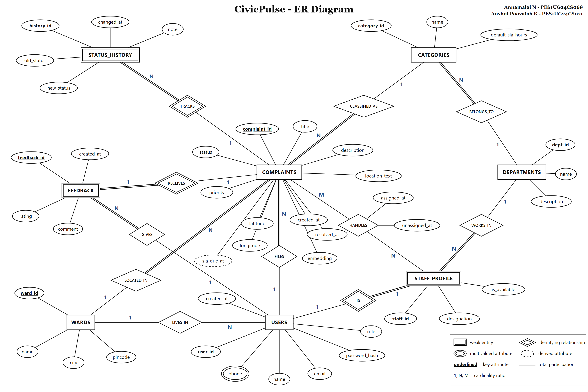

Summary:

| Entity | Type | Key |
|---|---|---|
| USERS | Strong | user_id; multivalued attribute phone |
| WARDS | Strong | ward_id |
| DEPARTMENTS | Strong | dept_id |
| CATEGORIES | Strong | category_id |
| COMPLAINTS | Strong | complaint_id; derived attribute sla_due_at |
| STAFF_PROFILE | Weak (identifying relationship IS with USERS) | staff_id |
| STATUS_HISTORY | Weak (identifying relationship TRACKS with COMPLAINTS) | history_id |
| FEEDBACK | Weak (identifying relationship RECEIVES with COMPLAINTS) | feedback_id |

| Relationship | Entities | Cardinality |
|---|---|---|
| LIVES_IN | USERS to WARDS | N : 1 |
| FILES | USERS to COMPLAINTS | 1 : N |
| LOCATED_IN | COMPLAINTS to WARDS | N : 1 |
| CLASSIFIED_AS | COMPLAINTS to CATEGORIES | N : 1 |
| BELONGS_TO | CATEGORIES to DEPARTMENTS | N : 1 |
| WORKS_IN | STAFF_PROFILE to DEPARTMENTS | N : 1 |
| IS | USERS to STAFF_PROFILE | 1 : 1 |
| HANDLES | COMPLAINTS to STAFF_PROFILE | M : N (attributes assigned_at, unassigned_at) |
| TRACKS | COMPLAINTS to STATUS_HISTORY | 1 : N |
| RECEIVES | COMPLAINTS to FEEDBACK | 1 : 1 |
| GIVES | USERS to FEEDBACK | 1 : N |

## 4. Relational schema

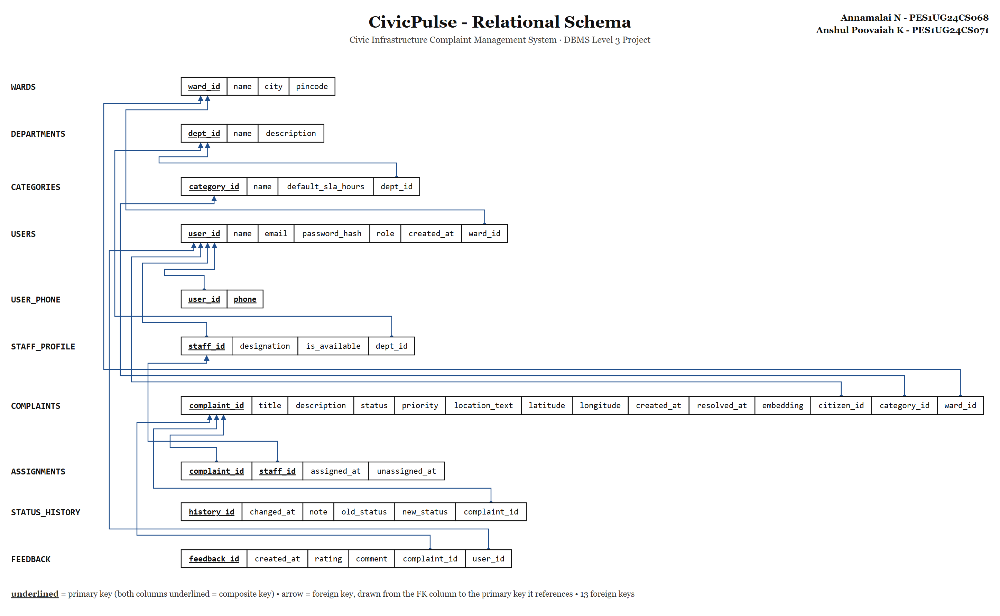

Primary keys are underlined in the diagram, and each arrow goes from a foreign key to the primary key it references. Below, PK and FK are marked.

```
WARDS          (ward_id PK, name, city, pincode)
DEPARTMENTS    (dept_id PK, name, description)
CATEGORIES     (category_id PK, name, default_sla_hours, dept_id FK→DEPARTMENTS)
USERS          (user_id PK, name, email, password_hash, role, created_at, ward_id FK→WARDS)
USER_PHONE     (user_id PK FK→USERS, phone PK)
STAFF_PROFILE  (staff_id PK FK→USERS, designation, is_available, dept_id FK→DEPARTMENTS)
COMPLAINTS     (complaint_id PK, title, description, status, priority, location_text,
                latitude, longitude, created_at, resolved_at, embedding,
                citizen_id FK→USERS, category_id FK→CATEGORIES, ward_id FK→WARDS)
ASSIGNMENTS    (complaint_id PK FK→COMPLAINTS, staff_id PK FK→STAFF_PROFILE,
                assigned_at, unassigned_at)
STATUS_HISTORY (history_id PK, changed_at, note, old_status, new_status,
                complaint_id FK→COMPLAINTS)
FEEDBACK       (feedback_id PK, created_at, rating, comment,
                complaint_id FK→COMPLAINTS UNIQUE, user_id FK→USERS)
```

Mapping decisions:

- The multivalued attribute **phone** becomes the separate table USER_PHONE with composite key (user_id, phone).
- The M:N relationship **HANDLES** becomes ASSIGNMENTS with composite key (complaint_id, staff_id) and its own attributes. A partial unique index allows only one *active* assignment per complaint while keeping the full assignment history.
- Weak entities carry the key of their owner as a foreign key with `ON DELETE CASCADE`.
- The derived attribute **sla_due_at** is not stored; it is computed in the view `v_complaint_details` as `created_at + default_sla_hours`, so it can never become inconsistent.
- The 1:1 **RECEIVES** relationship is enforced with `UNIQUE (complaint_id)` on FEEDBACK.

## 5. Database choice and justification

| Data | Store | Why |
|---|---|---|
| Users, wards, departments, categories, complaints, assignments, history, feedback | PostgreSQL relational tables | Highly structured and connected data. Foreign keys, CHECK constraints, triggers and transactions are needed so a complaint can never point to a missing ward, skip workflow steps, or be assigned to the wrong department. |
| Meaning of complaint text | pgvector `VECTOR(384)` column in the same PostgreSQL database | Complaints are free text written differently by different people ("crater on the road" vs "deep pothole"). Exact-word search misses duplicates; embeddings capture meaning. |

Keeping vectors in PostgreSQL (rather than a separate vector service) means a similarity query can be joined with relational data (ward, category, status) in one SQL statement, a complaint and its embedding are written in the same transaction, and deleting a complaint removes its vector automatically. Full-text search (GIN, `tsvector`) is kept alongside for exact keyword matching, so both search styles can be compared in the demo.

## 6. Data dictionary

### wards
| Column | Type | Constraints | Description |
|---|---|---|---|
| ward_id | SERIAL | PK | Ward identifier |
| name | VARCHAR(100) | NOT NULL, length ≥ 2, UNIQUE with city | Ward name |
| city | VARCHAR(60) | NOT NULL, default 'Bengaluru' | City |
| pincode | CHAR(6) | NOT NULL, regex `^[1-9][0-9]{5}$` | Indian PIN code |

### departments
| Column | Type | Constraints | Description |
|---|---|---|---|
| dept_id | SERIAL | PK | Department identifier |
| name | VARCHAR(100) | NOT NULL, UNIQUE | Department name |
| description | TEXT | | Responsibilities |

### categories
| Column | Type | Constraints | Description |
|---|---|---|---|
| category_id | SERIAL | PK | Category identifier |
| name | VARCHAR(100) | NOT NULL, UNIQUE | e.g. Pothole, Open manhole |
| default_sla_hours | INT | NOT NULL, 1 to 720 | Response target in hours |
| dept_id | INT | NOT NULL, FK → departments (RESTRICT) | Responsible department |

### users
| Column | Type | Constraints | Description |
|---|---|---|---|
| user_id | SERIAL | PK | User identifier |
| name | VARCHAR(100) | NOT NULL, length ≥ 2 | Full name |
| email | VARCHAR(150) | NOT NULL, email regex, unique on lower(email) | Login email |
| password_hash | TEXT | NOT NULL, length ≥ 20 | bcrypt hash |
| role | VARCHAR(10) | NOT NULL, CITIZEN / STAFF / ADMIN | Access role |
| created_at | TIMESTAMPTZ | NOT NULL, default now() | Registration time |
| ward_id | INT | FK → wards (SET NULL) | Ward the user lives in |

### user_phone
| Column | Type | Constraints | Description |
|---|---|---|---|
| user_id | INT | PK, FK → users (CASCADE) | Owner |
| phone | VARCHAR(10) | PK, regex `^[6-9][0-9]{9}$` | Indian mobile number |

### staff_profile
| Column | Type | Constraints | Description |
|---|---|---|---|
| staff_id | INT | PK, FK → users (CASCADE); trigger: user must have role STAFF | Staff member |
| designation | VARCHAR(80) | NOT NULL, length ≥ 2 | Job title |
| is_available | BOOLEAN | NOT NULL, default TRUE | Can take new complaints |
| dept_id | INT | NOT NULL, FK → departments (RESTRICT) | Department |

### complaints
| Column | Type | Constraints | Description |
|---|---|---|---|
| complaint_id | SERIAL | PK | Complaint identifier |
| title | VARCHAR(150) | NOT NULL, 5 to 150 chars | Short summary |
| description | TEXT | NOT NULL, 10 to 2000 chars | Details |
| status | VARCHAR(12) | NOT NULL, one of 6 states; transitions checked by trigger | Workflow state |
| priority | VARCHAR(8) | NOT NULL, LOW / MEDIUM / HIGH / CRITICAL | Urgency |
| location_text | VARCHAR(255) | NOT NULL, length ≥ 3 | Landmark or address |
| latitude, longitude | NUMERIC(9,6) | ranges ±90 / ±180, both or neither | GPS position |
| created_at | TIMESTAMPTZ | NOT NULL, default now() | Filing time |
| resolved_at | TIMESTAMPTZ | ≥ created_at; set only when RESOLVED/CLOSED (trigger) | Resolution time |
| embedding | VECTOR(384) | HNSW index (cosine) | Sentence embedding of title + description + location |
| citizen_id | INT | NOT NULL, FK → users (RESTRICT) | Who filed it |
| category_id | INT | NOT NULL, FK → categories (RESTRICT) | What kind of problem |
| ward_id | INT | NOT NULL, FK → wards (RESTRICT) | Where it is |

### assignments
| Column | Type | Constraints | Description |
|---|---|---|---|
| complaint_id | INT | PK, FK → complaints (CASCADE) | Complaint |
| staff_id | INT | PK, FK → staff_profile (RESTRICT) | Staff member |
| assigned_at | TIMESTAMPTZ | NOT NULL, default now() | Start of assignment |
| unassigned_at | TIMESTAMPTZ | ≥ assigned_at; NULL means active; one active row per complaint | End of assignment |

### status_history
| Column | Type | Constraints | Description |
|---|---|---|---|
| history_id | SERIAL | PK | History entry |
| changed_at | TIMESTAMPTZ | NOT NULL, default now() | When the change happened |
| note | TEXT | | Who changed it and why |
| old_status | VARCHAR(12) | valid status or NULL | Previous status |
| new_status | VARCHAR(12) | NOT NULL, valid status | New status |
| complaint_id | INT | NOT NULL, FK → complaints (CASCADE) | Complaint |

### feedback
| Column | Type | Constraints | Description |
|---|---|---|---|
| feedback_id | SERIAL | PK | Feedback identifier |
| created_at | TIMESTAMPTZ | NOT NULL, default now() | Time of rating |
| rating | SMALLINT | NOT NULL, 1 to 5 | Satisfaction score |
| comment | TEXT | ≤ 1000 chars | Optional comment |
| complaint_id | INT | NOT NULL, UNIQUE, FK → complaints (CASCADE) | Rated complaint |
| user_id | INT | NOT NULL, FK → users (CASCADE); trigger: must be the filing citizen | Who rated |

## 7. SQL implementation

| File | Contents |
|---|---|
| `sql/01_schema.sql` | `CREATE EXTENSION`, `DROP ... CASCADE`, `CREATE TABLE` with constraints, foreign keys added with `ALTER TABLE`, indexes |
| `sql/02_functions_triggers.sql` | Functions, triggers and the stored procedure |
| `sql/03_views.sql` | Four views |
| `sql/04_seed.sql` | Seed data inserted through the same procedure and triggers the app uses |
| `sql/05_queries.sql` | Important queries and DML/DDL demonstrations |
| `sql/06_tests.sql` | 25 test cases |

### Indexes

| Index | Type | Purpose |
|---|---|---|
| `uq_users_email_lower` | Unique expression index on `lower(email)` | Case-insensitive unique login |
| `idx_complaints_status`, `_ward`, `_category`, `_citizen`, `_created_at` | B-tree | Filters and joins used by every list |
| `uq_assignments_active` | Partial unique index `WHERE unassigned_at IS NULL` | One active staff per complaint |
| `idx_assignments_staff_active` | Partial B-tree | Staff workload queries |
| `idx_history_complaint` | Composite B-tree | Timeline of one complaint |
| `idx_complaints_fts` | GIN on `to_tsvector(title || description)` | Full-text search |
| `idx_complaints_embedding` | HNSW `vector_cosine_ops` | Fast nearest-neighbour search |

### Advanced features

| Feature | Implementation |
|---|---|
| **Triggers** | `trg_complaints_before_insert` (every complaint starts OPEN), `trg_complaints_before_update` (valid transitions, active assignment required, maintains resolved_at), `trg_complaints_after_insert` / `trg_complaints_after_status` (writes status_history, releases assignments), `trg_staff_profile_role_check`, `trg_assignments_validate` (department match), `trg_feedback_validate`, `trg_feedback_close_complaint` |
| **Stored procedure / functions** | `assign_complaint` (procedure: row lock, validation, close old assignment, upsert new one, status change), `fn_auto_assign` (least-loaded available staff), `fn_is_valid_transition`, `fn_find_similar_complaints`, `fn_escalate_overdue` |
| **Views** | `v_complaint_details`, `v_department_performance`, `v_staff_workload`, `v_ward_summary` |
| **Transactions** | `withTransaction()` in `lib/db.js` wraps registration (user + phones), staff creation (user + profile + phone), status change (row lock + note + update) and assignment. The status note is passed to the trigger with the transaction-local setting `set_config('civicpulse.status_note', ..., true)`. |
| **Indexing** | See table above, including partial and expression indexes |
| **Full-text search** | `websearch_to_tsquery`, `ts_rank`, `ts_headline` |
| **Vector similarity search** | See section 8 |

### Complaint workflow enforced by the database

```
OPEN ──► ASSIGNED ──► IN_PROGRESS ──► RESOLVED ──► CLOSED
 │          │  ▲            │             │
 ▼          ▼  │            ▼             ▼
REJECTED  OPEN/REJECTED    OPEN       IN_PROGRESS (reopened)
```

Any other change raises an error from `trg_complaints_before_update`, even if attempted directly in psql.

## 8. Vector database and semantic search

| Question | Answer |
|---|---|
| What data is embedded? | Each complaint's title, description and landmark joined into one text: `"<title>. <description>. Location: <landmark>"`. Search queries are embedded the same way. |
| Which model? | `Xenova/all-MiniLM-L6-v2` (sentence-transformers MiniLM, ONNX build) run locally in Node.js with `@huggingface/transformers`, mean pooling and L2 normalisation. No API key and no data leaves the machine. |
| How are vectors stored? | In `complaints.embedding VECTOR(384)` (pgvector). The vector is computed in the API before the INSERT, so it is saved in the same row as the complaint. Seed data is embedded by `npm run db:embed`. |
| Index | HNSW with `vector_cosine_ops` (falls back to IVFFlat on old pgvector versions). |
| Similarity metric | Cosine distance, operator `<=>`. Similarity is reported as `1 - distance`. |
| Retrieval | `fn_find_similar_complaints(vector, limit, exclude_id, min_similarity)` orders by `embedding <=> query` and joins ward and category names. Thresholds: 0.5 for duplicate detection while filing, 0.45 for "similar complaints" on the detail page, 0.2 for free search. |

Use cases: duplicate detection while a citizen types, "similar complaints" on every complaint page (helps the admin merge or batch work), and meaning-based search for staff and admin.

## 9. Important queries

All are in `sql/05_queries.sql`; the most important ones are also used by the application.

Hotspot wards (GROUP BY, HAVING with a nested subquery), used on the admin dashboard:

```sql
SELECT w.name AS ward, COUNT(*) AS pending
FROM complaints c JOIN wards w ON w.ward_id = c.ward_id
WHERE c.status IN ('OPEN','ASSIGNED','IN_PROGRESS')
GROUP BY w.ward_id, w.name
HAVING COUNT(*) >= (SELECT AVG(cnt) FROM (
         SELECT COUNT(*) AS cnt FROM complaints
         WHERE status IN ('OPEN','ASSIGNED','IN_PROGRESS') GROUP BY ward_id) per_ward)
ORDER BY pending DESC;
```

Department SLA performance (view with FILTER aggregates):

```sql
SELECT dept_name, total_complaints, pending, overdue, avg_resolution_hours, sla_compliance_pct
FROM v_department_performance ORDER BY total_complaints DESC;
```

Least-loaded available staff in the responsible department (inside `fn_auto_assign`):

```sql
SELECT sp.staff_id
FROM complaints c
JOIN categories cat   ON cat.category_id = c.category_id
JOIN staff_profile sp ON sp.dept_id = cat.dept_id AND sp.is_available
LEFT JOIN assignments a ON a.staff_id = sp.staff_id AND a.unassigned_at IS NULL
LEFT JOIN complaints ac ON ac.complaint_id = a.complaint_id AND ac.status IN ('ASSIGNED','IN_PROGRESS')
WHERE c.complaint_id = $1
GROUP BY sp.staff_id
ORDER BY COUNT(ac.complaint_id), sp.staff_id
LIMIT 1;
```

Semantic duplicate search:

```sql
SELECT * FROM fn_find_similar_complaints($1::vector, 5, NULL, 0.5);
```

Full-text search with ranking and highlighted snippet:

```sql
SELECT c.complaint_id, c.title,
       ts_rank(to_tsvector('english', c.title || ' ' || c.description), tsq) AS score,
       ts_headline('english', c.description, tsq) AS snippet
FROM complaints c CROSS JOIN websearch_to_tsquery('english', $1) AS tsq
WHERE to_tsvector('english', c.title || ' ' || c.description) @@ tsq
ORDER BY score DESC;
```

## 10. System architecture

```
 Browser (React pages, Next.js App Router)
        │  fetch() JSON
        ▼
 middleware.js ── checks JWT cookie and role for each page
        │
        ▼
 API Route Handlers (app/api/**)
   ├─ requireUser(roles)        backend authorisation on every route
   ├─ lib/db.js                 pg connection pool, withTransaction()
   └─ lib/embeddings.js         local MiniLM model → 384-d vector
        │  parameterised SQL
        ▼
 PostgreSQL + pgvector
   tables, constraints, triggers, procedure, functions, views,
   GIN full-text index, HNSW vector index
```

Credentials are read only from environment variables (`.env.local`: `PGHOST`, `PGPORT`, `PGUSER`, `PGPASSWORD`, `PGDATABASE`, `JWT_SECRET`). Passwords are stored as bcrypt hashes. All SQL uses bound parameters, which prevents SQL injection.

## 11. Application screenshots

**1. Landing page**

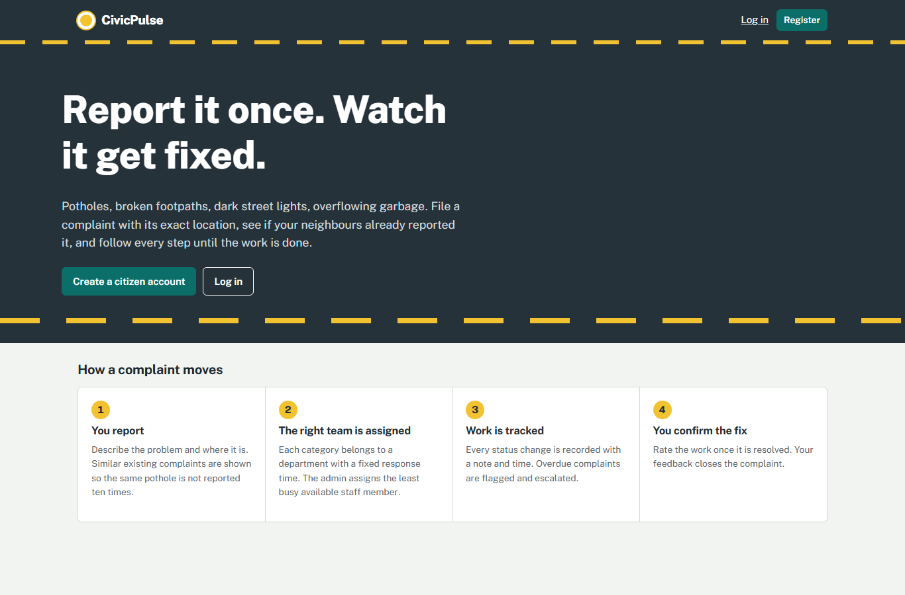

**2. Registration rejected by the database.** The phone number `12345` violates the CHECK constraint `chk_user_phone_format`, and the message comes from PostgreSQL.

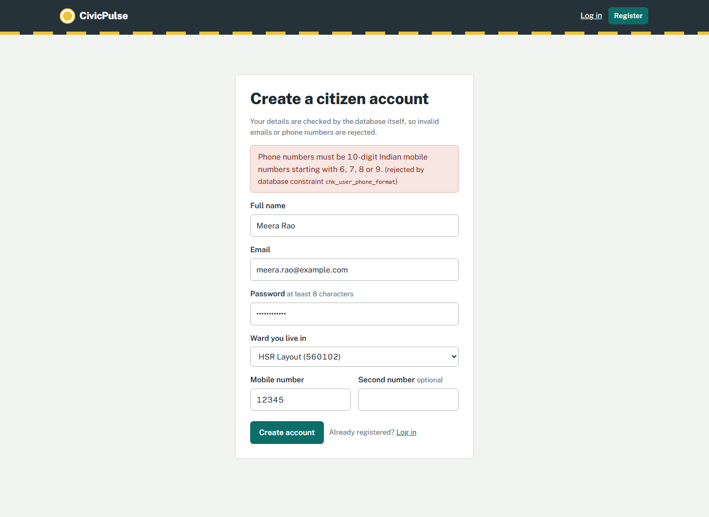

**3. Citizen reports an issue.** The "Already reported?" panel finds similar complaints by meaning (pgvector cosine similarity). "Big hole in the road outside the school gate" matches "Pothole near school entrance" even though the wording is different.

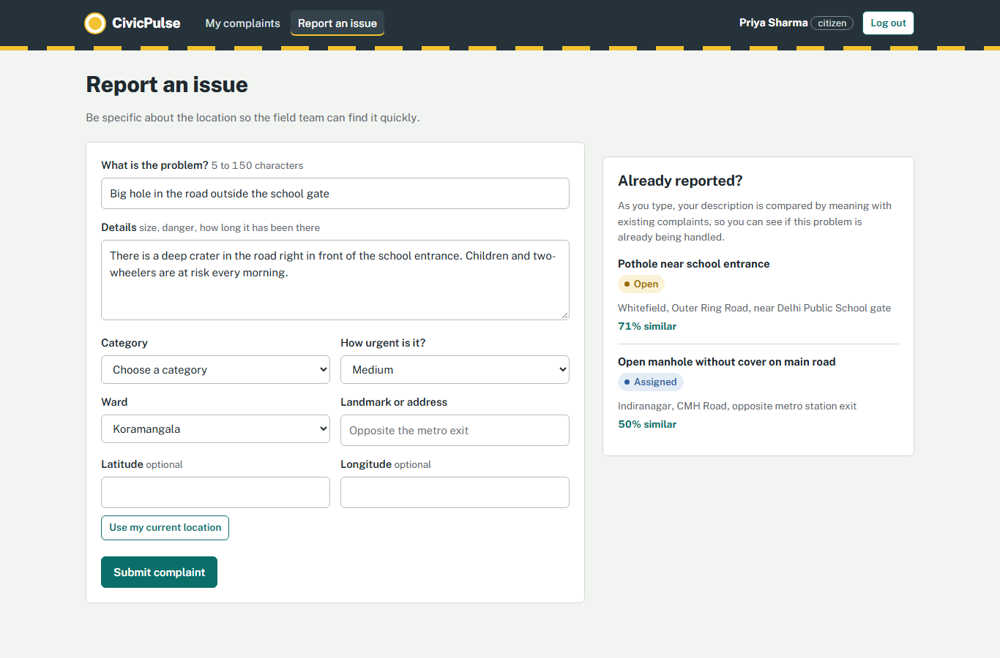

**4. Citizen: my complaints**

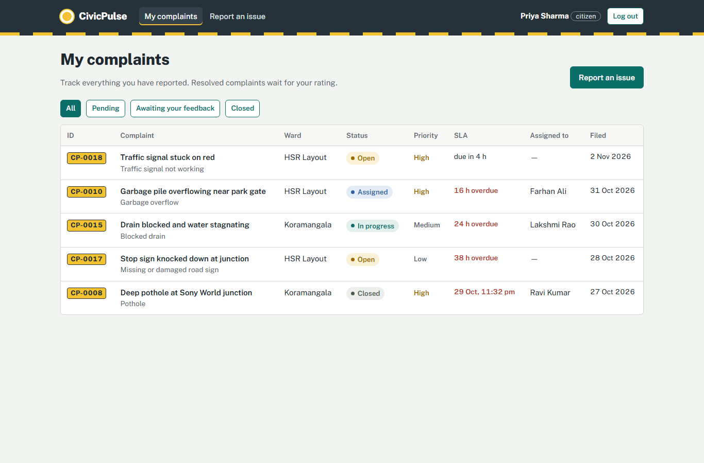

**5. Complaint detail.** The status timeline is written by triggers, and the page also shows the assignment history and the citizen's feedback.

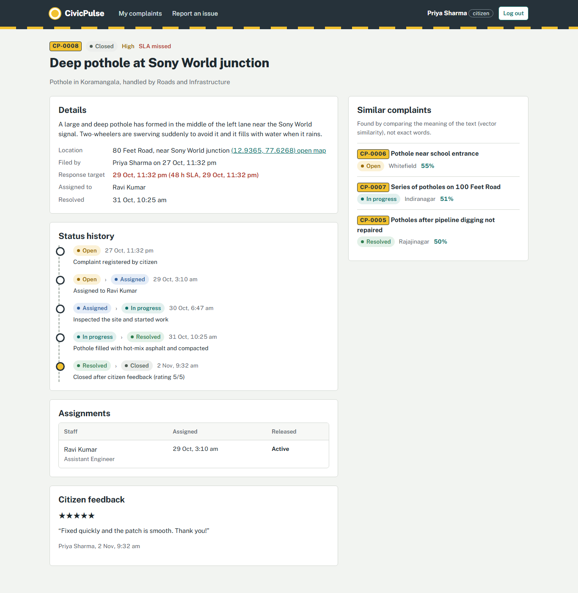

**6. Admin dashboard.** The figures come from views and GROUP BY / HAVING queries (department performance, hotspot wards, staff workload).

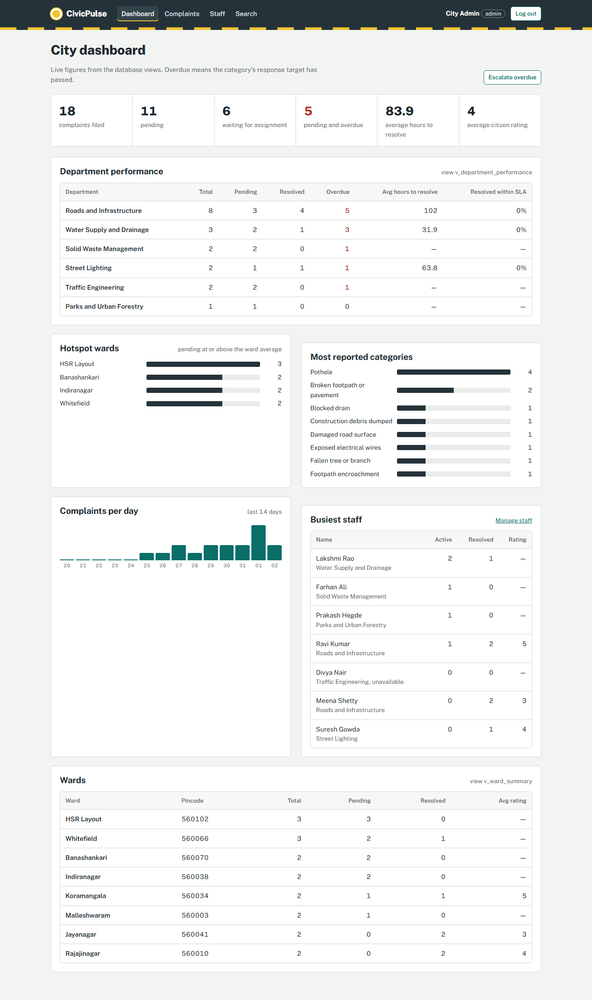

**7a. Admin auto-assign.** `fn_auto_assign` picks the least-loaded available staff member and calls the stored procedure `assign_complaint`.

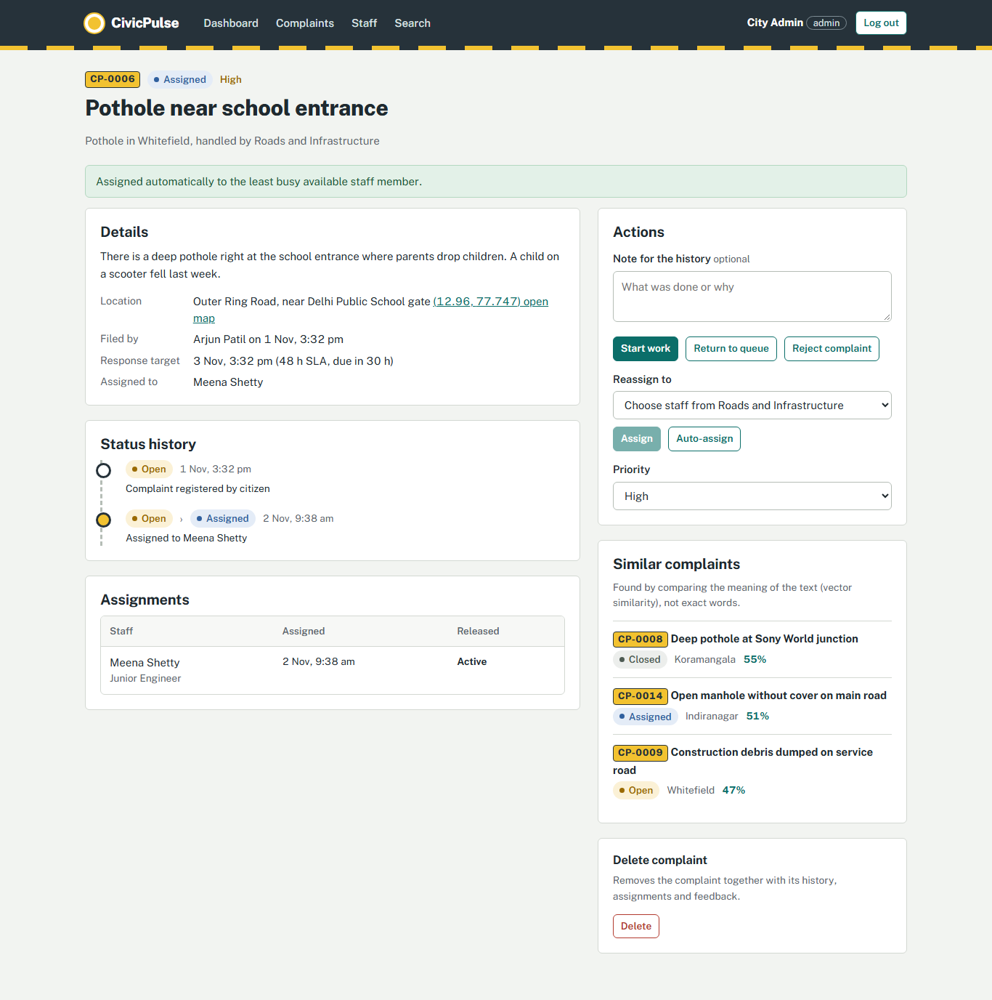

**7b. Auto-assign rejected.** The only Traffic Engineering staff member is unavailable, so the function raises "No available staff".

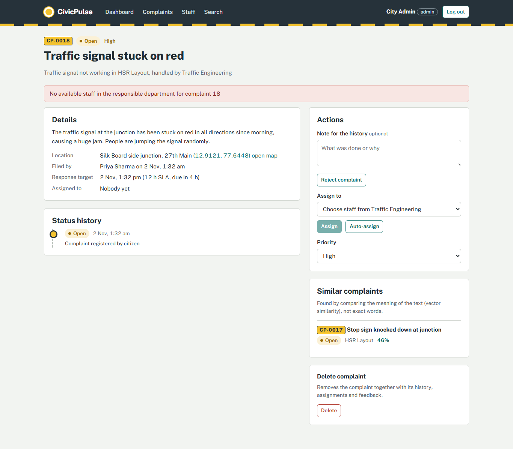

**8. Staff: my work and availability toggle**

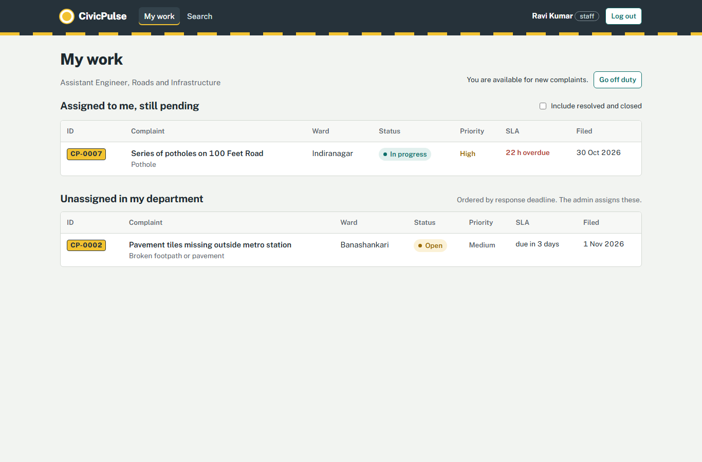

**9. Search: meaning vs keywords for the same query ("dark road at night")**

Meaning (vector) search ranks results by cosine similarity:

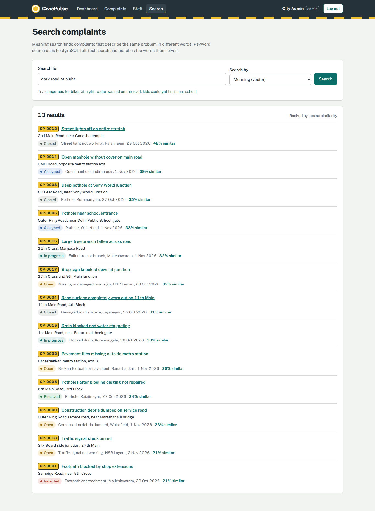

Keyword (full-text) search only matches the exact words, ranked with `ts_rank`:

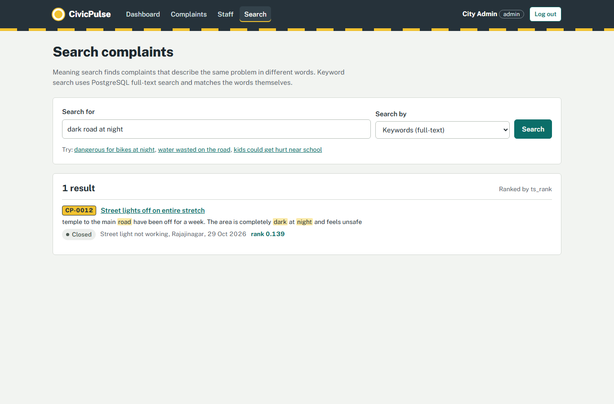

**10. Database test cases: `npm run db:test`**

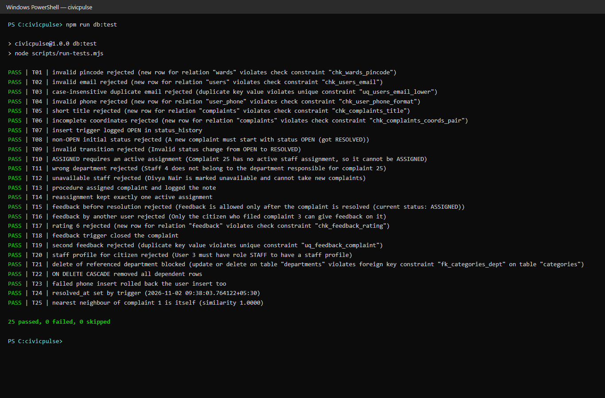

## 12. Testing results

Run `npm run db:test`. Each test runs inside a transaction that is rolled back. **Result: 25 passed, 0 failed** (screenshot 10).

| ID | Test | Expected result |
|---|---|---|
| T01 | Ward with invalid pincode | Rejected by `chk_wards_pincode` |
| T02 | User with invalid email | Rejected by `chk_users_email` |
| T03 | Duplicate email in different case | Rejected by `uq_users_email_lower` |
| T04 | Invalid phone number | Rejected by `chk_user_phone_format` |
| T05 | Complaint title shorter than 5 characters | Rejected by `chk_complaints_title` |
| T06 | Latitude without longitude | Rejected by `chk_complaints_coords_pair` |
| T07 | Insert complaint | First status_history row written by trigger |
| T08 | Insert complaint as RESOLVED | Rejected by insert trigger |
| T09 | OPEN → RESOLVED | Rejected as invalid transition |
| T10 | ASSIGNED without assignment | Rejected by update trigger |
| T11 | Assign staff from another department | Rejected by `trg_assignments_validate` |
| T12 | Assign unavailable staff | Rejected by procedure |
| T13 | Assign with procedure | Status ASSIGNED, one active assignment, note logged |
| T14 | Reassign | Old assignment closed, exactly one active |
| T15 | Feedback before resolution | Rejected by feedback trigger |
| T16 | Feedback by another citizen | Rejected by feedback trigger |
| T17 | Rating 6 | Rejected by `chk_feedback_rating` |
| T18 | Valid feedback on RESOLVED complaint | Complaint becomes CLOSED automatically |
| T19 | Second feedback | Rejected by `uq_feedback_complaint` |
| T20 | Staff profile for a citizen | Rejected by role-check trigger |
| T21 | Delete department still in use | Blocked by FK RESTRICT |
| T22 | Delete complaint | History, assignments, feedback removed by CASCADE |
| T23 | User insert followed by invalid phone in one block | Both rolled back (atomicity) |
| T24 | IN_PROGRESS → RESOLVED | resolved_at filled by trigger |
| T25 | Nearest neighbour of a complaint's own vector | The complaint itself, similarity ≈ 1.0 |

Application-level checks performed manually: login for each role, page access blocked for the wrong role, API returns 401/403 without the right session, duplicate detection, assignment, status changes, feedback, delete, search in both modes.

## 13. Conclusion

CivicPulse turns scattered civic complaints into a tracked workflow. PostgreSQL holds the structured data and enforces the rules that matter most: valid status changes, correct department assignment, one active assignee, one feedback per complaint and well-formed inputs. Triggers keep an automatic audit trail, a stored procedure performs assignment atomically, and views compute derived values such as SLA deadlines and department performance. pgvector adds meaning-based search inside the same database, which catches duplicate reports that keyword search misses. Possible extensions are photo uploads, map-based clustering of nearby complaints, notifications by SMS or email, and automatic category suggestion from the complaint text using the same embeddings.
